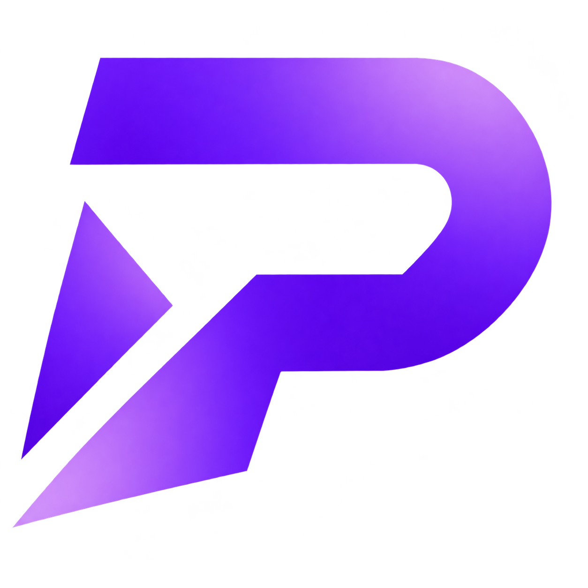
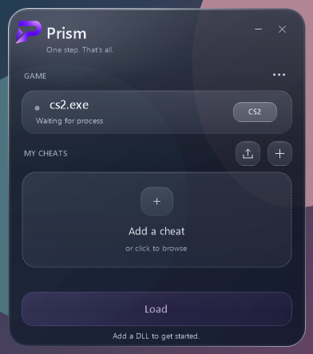
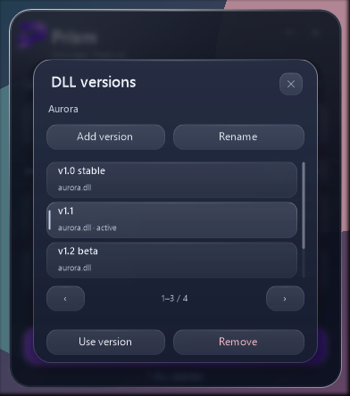
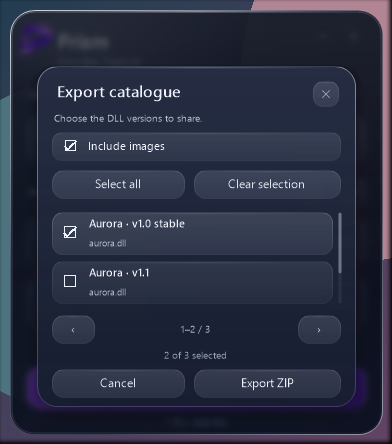

<div align="center">



# Prism

**Your DLLs. Their versions. One place.**<br>
A visual library and Windows loader for Counter-Strike 2.

[](https://github.com/depre99ed/Prism/releases/latest)

[](https://github.com/depre99ed/Prism/releases/latest)


[](https://github.com/depre99ed/Prism/actions/workflows/checks.yml)

[Features](#features) · [Download](#download) · [Local data](#local-data) · [Developers](docs/BUILD.md) · [Français](README.md)

<br>



<sub>Native interface render. The application is in English.</sub>

</div>

<br>

## Why Prism

Keep your DLLs in one library, give each entry a name and artwork, and preserve the versions you want to keep.
Prism brings the catalogue, version selection and loading into a compact Windows window.

- **Multiple versions per entry.** Pick an active version without losing the previous ones.
- **Stored copies.** Added versions are copied into the application’s data folder.
- **Selective sharing.** Export selected versions and their artwork as a ZIP archive.
- **Readable diagnostics.** Review the failed stage, returned error code and available traces.

Prism is derived from [Xenos](https://github.com/DarthTon/Xenos), using [Blackbone](https://github.com/DarthTon/Blackbone).
It loads code into the game process. **There is no guarantee of anti-cheat compatibility or protection from account sanctions.**
The complete CS2 flow has not been verified for this publication.

## Features

| | What you can do |
|---|---|
| **Library** | Add a native x64 DLL, set its title and artwork, and find it in the catalogue. |
| **Versions** | Keep multiple copies, label each version and choose the active one. |
| **ZIP archives** | Select versions to export, include artwork and import shared catalogues. |
| **Diagnostics** | Review error history and export selected entries using the application’s path-redaction feature. |
| **CS2 flow** | Request a normal game close, restart through Steam and wait for readiness before loading. |
| **Native interface** | Compact window, transparency, transitions and support for several Windows display scales. |

<div align="center">
<table>
<tr>
<td align="center" width="50%"><strong>Find a version</strong><br><br></td>
<td align="center" width="50%"><strong>Choose what to share</strong><br><br></td>
</tr>
</table>
<sub>Captures generated by the actual renderer using example data. No DLL was executed to produce them.</sub>
</div>

## Download

The [latest release](https://github.com/depre99ed/Prism/releases/latest) includes:

| File | Contents |
|---|---|
| `Prism.exe` | The unchanged original **1.1.1.1.2.7** executable. |
| `Prism-1.1.1.1.2.7-windows-x64.zip` | The same executable, notices and bundled license texts. |
| `SHA256SUMS.txt` | SHA-256 checksums for the release files. |
| `Source code` | Sources at the release tag, available as ZIP or tar.gz from GitHub. |

There is no installer: extract the ZIP to a folder of your choice. The executable’s manifest requests administrator privileges.
The interface is in English. No cheat or personal catalogue is supplied; inherited engine components are embedded in the program.

Verify the download in PowerShell:

```powershell
Get-FileHash .\Prism.exe -Algorithm SHA256
```

Compare the result with `SHA256SUMS.txt`. This checks the downloaded bytes, not a DLL’s compatibility with the game.

## Local data

The profile, artwork, DLL copies and diagnostics live in `%LOCALAPPDATA%\Prisme`.
This version retains the original folder name.

A catalogue export contains the DLLs and artwork you select. Review its contents before sharing it.
The inherited engine can access Microsoft symbol servers; its complete network behaviour has not been tested here.

## Publication checks

| Check performed on November 14, 2026 | Result |
|---|---|
| Released executable versus original copy | Identical SHA-256, byte for byte |
| Exported source build | Release x64 succeeded |
| Profile, catalogue, version, ZIP and diagnostic tests | Passed with isolated fixtures |
| Rendering and hit-target tests, 100–200% display scales | Passed, no reported failures |
| Real injection, real CS2 restart, anti-cheat, another PC | Not tested |

The rebuilt binary verifies buildability; the release distributes the original binary.
A byte-for-byte reproducible build is not guaranteed.
See [build and tests](docs/BUILD.md) and [provenance](docs/PROVENANCE.md).

## Credits and licenses

Prism retains code and notices from **Xenos / Blackbone**, created by **DarthTon**.
The inherited MIT text is in [`LICENSE`](LICENSE). Dependencies retain their own licenses and notices;
see [`THIRD_PARTY_NOTICES.md`](THIRD_PARTY_NOTICES.md).
