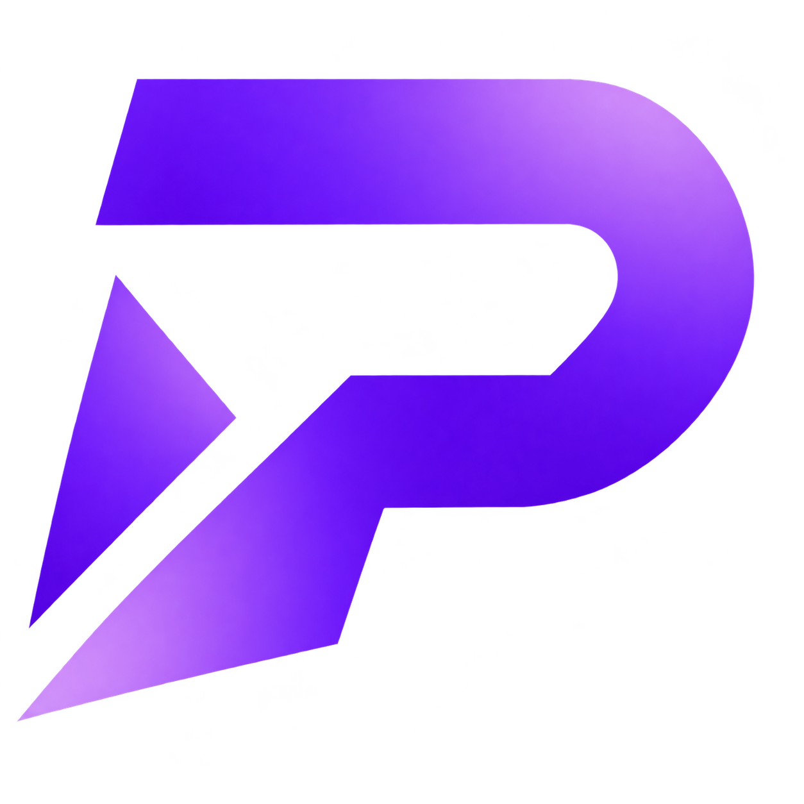
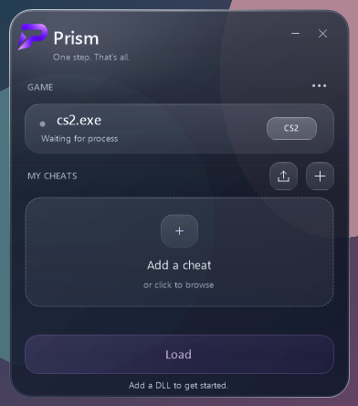
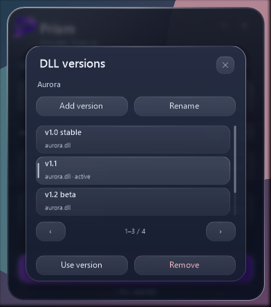
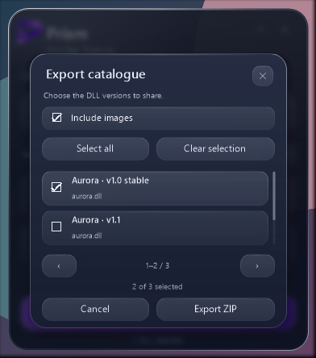

<div align="center">



# Prism

**Tes DLL, leurs versions, un seul endroit.**<br>
Un catalogue visuel et un loader Windows pour Counter-Strike 2.

[](https://github.com/depre99ed/Prism/releases/latest)

[](https://github.com/depre99ed/Prism/releases/latest)


[](https://github.com/depre99ed/Prism/actions/workflows/checks.yml)

[Fonctionnalités](#fonctionnalités) · [Télécharger](#télécharger) · [Données locales](#données-locales) · [Développeurs](docs/BUILD.md) · [English](README.en.md)

<br>



<sub>Rendu de l’interface native. L’application est en anglais.</sub>

</div>

<br>

## Pourquoi Prism

Garde tes DLL dans une bibliothèque, donne-leur un nom et une image, et retrouve les versions que tu veux conserver.
Prism réunit le catalogue, le choix de version et le chargement dans une petite fenêtre Windows.

- **Plusieurs versions par entrée.** Choisis une version active sans perdre les précédentes.
- **Des copies conservées.** Les versions ajoutées sont copiées dans le dossier de l’application.
- **Un partage à la carte.** Exporte les versions choisies et leurs images dans un ZIP.
- **Des erreurs lisibles.** Consulte l’étape concernée, le code retourné et les traces disponibles.

Prism est un dérivé de [Xenos](https://github.com/DarthTon/Xenos), basé sur [Blackbone](https://github.com/DarthTon/Blackbone).
Il charge du code dans le processus du jeu. **Aucune garantie de compatibilité avec les anti-triche ou d’absence de sanction n’est donnée.**
Le parcours complet avec CS2 n’a pas été vérifié pour cette publication.

## Fonctionnalités

| | Ce que tu peux faire |
|---|---|
| **Bibliothèque** | Ajouter une DLL native x64, lui donner un titre et une image, puis la retrouver dans le catalogue. |
| **Versions** | Conserver plusieurs copies, nommer chaque version et choisir celle qui est active. |
| **Archives ZIP** | Choisir les versions à exporter, inclure leurs images et importer un catalogue partagé. |
| **Diagnostics** | Lire l’historique des erreurs et exporter les entrées sélectionnées avec masquage des chemins prévu par l’application. |
| **Parcours CS2** | Demander une fermeture normale du jeu, le relancer via Steam et attendre sa disponibilité avant le chargement. |
| **Interface native** | Fenêtre compacte, transparence, transitions et prise en charge de plusieurs échelles d’affichage Windows. |

<div align="center">
<table>
<tr>
<td align="center" width="50%"><strong>Retrouver une version</strong><br><br></td>
<td align="center" width="50%"><strong>Choisir ce qu’on partage</strong><br><br></td>
</tr>
</table>
<sub>Captures produites par le véritable moteur graphique avec des données d’exemple. Aucune DLL n’a été exécutée pour les produire.</sub>
</div>

## Télécharger

La [dernière release](https://github.com/depre99ed/Prism/releases/latest) contient :

| Fichier | Contenu |
|---|---|
| `Prism.exe` | L’exécutable original de la version **1.1.1.1.2.7**, conservé à l’identique. |
| `Prism-1.1.1.1.2.7-windows-x64.zip` | Le même exécutable, les notices et les textes de licence livrés avec cette version. |
| `SHA256SUMS.txt` | Les empreintes des fichiers de la release. |
| `Source code` | Les sources du tag, disponibles au format ZIP ou tar.gz sur GitHub. |

Il n’y a pas d’installeur : extrais le ZIP dans un dossier de ton choix. Le manifeste de l’exécutable demande les droits administrateur.
L’interface est en anglais. Aucun cheat ni catalogue personnel n’est fourni ; les composants hérités du moteur sont déjà intégrés au programme.

Pour vérifier le téléchargement dans PowerShell :

```powershell
Get-FileHash .\Prism.exe -Algorithm SHA256
```

Compare le résultat à `SHA256SUMS.txt`. Cette vérification contrôle les octets du téléchargement, pas la compatibilité d’une DLL avec le jeu.

## Données locales

Le profil, les images, les copies de DLL et les diagnostics sont conservés dans `%LOCALAPPDATA%\Prisme`.
Le dossier garde son ancien nom pour cette version.

Un export de catalogue contient les DLL et les images que tu sélectionnes. Vérifie son contenu avant de le partager.
Le moteur hérité peut consulter les serveurs de symboles Microsoft ; le comportement réseau complet n’a pas été testé ici.

## Vérifications de cette publication

| Vérification du 14 novembre 2026 | Résultat |
|---|---|
| Exécutable livré / exemplaire original | Même SHA-256, octet pour octet |
| Compilation des sources exportées | Réussie en Release x64 |
| Tests profils, catalogue, versions, ZIP et diagnostics | Réussis sur données isolées |
| Tests du rendu et des zones cliquables, de 100 % à 200 % | Réussis, aucune erreur signalée |
| Injection réelle, redémarrage réel de CS2, anti-triche, autre PC | Non testés |

Le binaire recompilé sert à vérifier que les sources compilent ; la release distribue le binaire original.
La reproductibilité octet pour octet de la compilation n’est pas garantie.
Détails : [compilation et tests](docs/BUILD.md), [provenance](docs/PROVENANCE.md).

## Crédits et licences

Prism conserve le code et les notices de **Xenos / Blackbone**, créés par **DarthTon**.
Le texte MIT hérité se trouve dans [`LICENSE`](LICENSE). Les dépendances gardent leurs propres licences et notices ;
voir [`THIRD_PARTY_NOTICES.md`](THIRD_PARTY_NOTICES.md).
